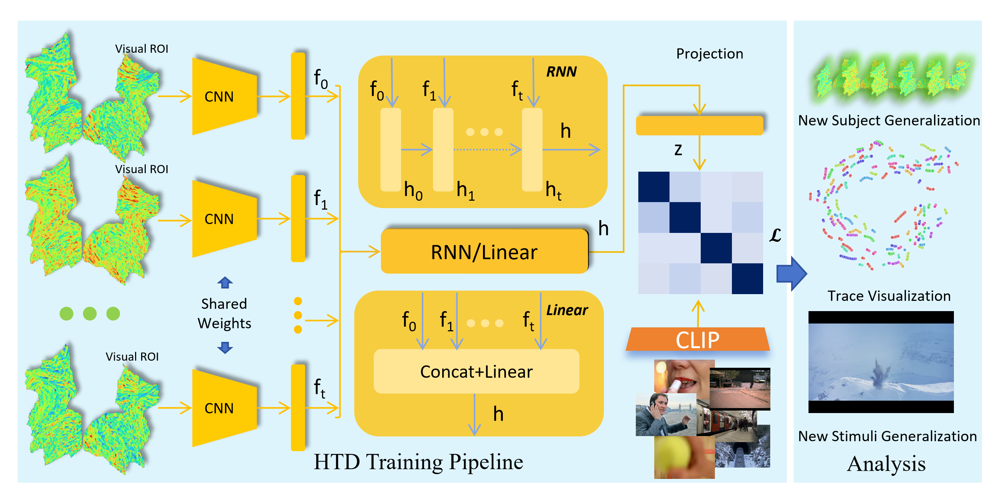

# HTD: Hierarchical Trajectory Decoder for Cross-Subject Visual Brain Decoding

Official code release for **"Learning Shared BOLD Trajectories for Cross-Subject Visual Brain Decoding"**.

Most fMRI decoding pipelines compress the BOLD response into a **static snapshot** (a single delayed frame or a temporal average), which discards the temporal nature of the haemodynamic response. **HTD** instead models a short **BOLD trajectory** and maps it to the CLIP semantic space:

1. **Frame-wise spatial encoder** — a time-invariant 2D CNN + residual MLPs extracts a feature for every cortical activation map in the window.
2. **Temporal fusion** — an RNN (`rnn_last`) or a linear layer (`mlp`) integrates the ordered frame features into one trajectory representation.
3. **Semantic projection** — a lightweight head projects the trajectory into a 768-d CLIP embedding, trained with a bidirectional contrastive (SoftCLIP) objective.



> **Note:** This repository currently releases the **core HTD training / evaluation pipeline**. Code for additional baselines, ablations and analyses is coming soon.

---

## Repository structure

```
HTD_src/
├── train.py                     # training entry point
├── test.py                      # evaluation entry point
├── model/
│   ├── Brain_Model.py           # LightningModule: losses, logging, train/val/test loops, metrics
│   └── network.py               # HTD spatial encoder + temporal fusion variants
├── data/
│   ├── Brain_Dataloader.py      # LightningDataModule
│   ├── HCP_Datasets.py          # HCP train/val/test datasets + feature / fMRI preprocessing
│   └── vc_masks.npy             # visual-cortex ROI mask (256×256)
├── options/
│   ├── HTD_RNN.yaml             # demo config (single subject, quick smoke test)
│   └── HTD_RNN_full.yaml        # full config (165 training / 10 unseen subjects)
├── lists/
│   ├── train.txt                # IID stimulus split (2333 time points, Movies 1–3)
│   ├── test_seen.txt            # retest ("seen") stimuli from Movie 4
│   └── test_novel.txt           # held-out ("novel") stimuli from Movie 4
├── dataset/HCP/                 # data root (see Data)
├── materials/                    # pre-computed result tables used for plotting
└── figs/pipeline.png
```

---

## Installation

```bash
conda create -n htd python=3.10 -y
conda activate htd

# PyTorch matching your CUDA version, e.g. cu118
pip install torch torchvision --index-url https://download.pytorch.org/whl/cu118

pip install "pytorch-lightning>=2.1" omegaconf einops timm kornia \
            scikit-learn h5py pillow pandas numpy
```

An NVIDIA GPU is required (`pytorch-lightning` runs with the DDP strategy and AMP).

---

## Data

We use the **HCP 7T movie-watching dataset** (1200 Subjects Release, <https://humanconnectome.org>). Each subject watched four ~15-minute movies; TR = 1 s. Following the paper, resting periods are removed and 3027 valid time points are kept per subject. 175 subjects with complete cortical data are used: 165 for training (seen) and 10 held out (unseen).

The volumetric BOLD time series were projected onto the cortical surface, restricted to visual ROIs, and flattened into 256×256 activation maps. We refer readers to [cortex_image](https://github.com/cnwangy/cortex_image) for further details.

Expected layout (paths are set in `options/*.yaml` and in `data/HCP_Datasets.py`):

```
dataset/HCP/
├── preprocessed_data/<subject_id>/MOVIE{1..4}_image.npy       # 256×256 visual-cortex activation maps
└── preprocessed_stimulis/7T_MOVIE{1..4}_*_all_clip_embed.npy   # CLIP ViT-L/14 targets (768-d)
data/vc_masks.npy                                               # visual-cortex ROI mask
```

**Bundled data.** This repo ships the CLIP targets for all four movies under `dataset/HCP/preprocessed_stimulis/`.

**Example preprocessed data.** The example activation maps used by the demo config `options/HTD_RNN.yaml` (one subject, all four movies) are not included in this repository; download them from [this Dropbox folder](https://www.dropbox.com/scl/fo/fgg6nuf3wv7jynkdqit73/AIhdqUFv-M_MRTzNCWL04Vg?rlkey=uxym8t7bmurefkrlgmwbz2gqa&st=ict80krd&dl=0) and place them under `dataset/HCP/preprocessed_data/<subject_id>/`, then point `fmri_data_path` to that folder to run the flow end-to-end.

**Full dataset.** The complete 175-subject activation maps are not shipped with this repository, but are available **on demand** — please contact the authors to request access. Preprocessing can be reproduced with [cortex_image](https://github.com/cnwangy/cortex_image).

> **Before running on your own machine, update the absolute paths** in `options/HTD_RNN.yaml` (`default_root_dir`, `fmri_data_path`), in `data/HCP_Datasets.py` (the `feature`/`mask` paths) to match your local layout.

---

## Quick start

```bash
# Train (demo config: single subject)
python train.py --opt options/HTD_RNN.yaml

# Evaluate a trained checkpoint (path taken from `model_path` in the config)
python test.py  --opt options/HTD_RNN.yaml
```

Training writes logs, TensorBoard events and checkpoints under
`results/<exp_name>/`; the retrieved metrics are also printed to stdout and dumped to a timestamped `.txt` log file.

**Full setting.** `options/HTD_RNN_full.yaml` trains on 165 subjects and evaluates zero-shot on the 10 unseen subjects:

```bash
python train.py --opt options/HTD_RNN_full.yaml
```

---

## Configuration

All hyper-parameters live in `options/*.yaml` and are passed to the model / datamodule as an `argparse.Namespace`. The most relevant keys:

| Key | Description |
| --- | --- |
| `network` | `BrainNetwork_mindeye_2d_fuse` (hierarchical, supports fusion) or `BrainNetwork_mindeye_2d_light` (single-frame encoder) |
| `n_times` | Trajectory length `T` (number of consecutive BOLD frames, default `5`) |
| `fuse_method` | Temporal fusion: `rnn_last` / `rnn_average` (HTD RNN) or `mlp` (HTD Linear) |
| `fmri_type` | fMRI preprocessing: `concat5s` (trajectory `T×256×256`, default), `mix5s`, `concat1s_delay5` |
| `img_type` | CLIP target key (`all_clip_embed`) |
| `loss_type` | `SoftCLIPLoss` (default), `CLIPLoss`, `BiMixCo_SoftCLIP`, `MSE` |
| `train_subjs` / `val_subjs` / `test_subjs` | Subject lists for each split |
| `model_path` | Checkpoint used by `test.py` |

HTD Linear is obtained simply by switching `fuse_method: mlp`; a static "Averaged Frames" baseline corresponds to `fmri_type: mix5s` (window averaged into a single map). Dedicated implementations of the remaining baselines and ablations will be released soon.


## Licence

Released under the Apache License 2.0 (see `LICENSE`).
